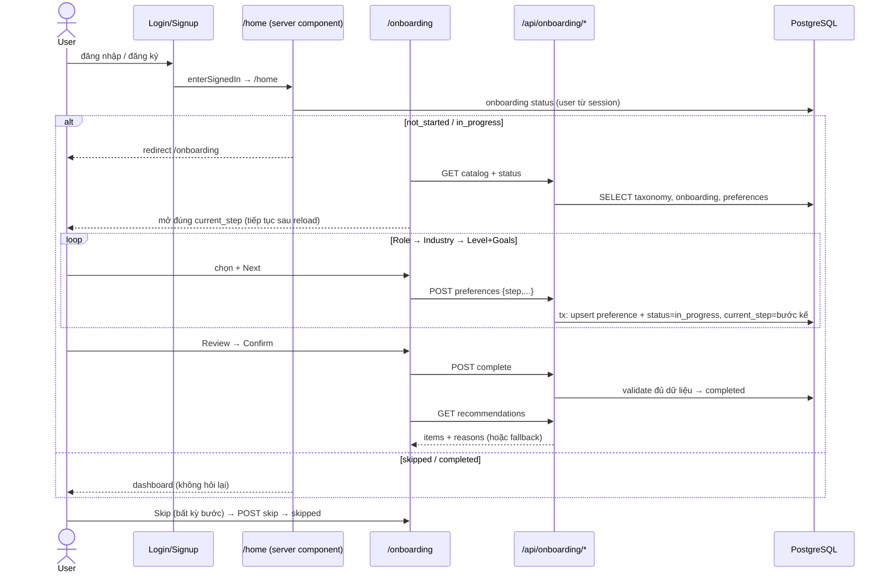
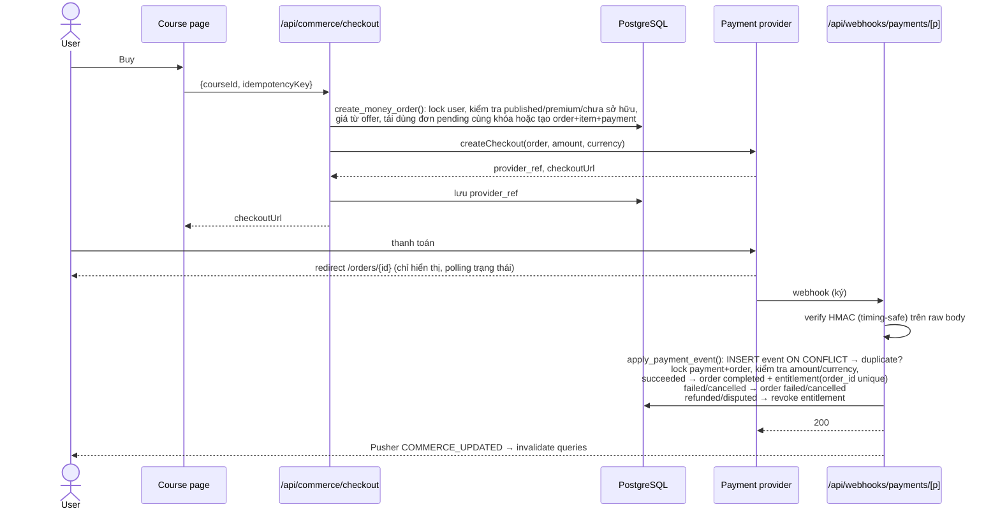

# Onboarding cá nhân hóa + Khóa học Free/Premium (tiền & Point)

Cập nhật: 2026-10-17. Hai tính năng dùng chung một hệ metadata (role / industry / skill / level /
goal / prerequisite / learning path) trên PostgreSQL. Tài liệu gồm 11 mục được yêu cầu trước khi
sửa code; phần "Khác biệt so với mô tả" và "Quyết định cần xác nhận" ở cuối.

---

## 1. Audit codebase (hiện trạng thực tế)

| Mảng | Hiện trạng | Hệ quả cho thiết kế |
|---|---|---|
| Auth | `lib/session.js` `getAuthSession` / `requireAuthSession`; `session.user.id` = `identity.users.public_id` (ULID). Server action qua `lib/serverAction.js` `runAction` (`{success,data}` / `{success:false,status,message,code}`), client dùng `unwrapActionResult` + `callWithAuthRetry`. | Mọi API mới lấy user từ session, không nhận `user_id` từ client. |
| RBAC | Bảng `identity.roles/permissions/role_permissions/user_roles` có sẵn. Permission `"resource.action"` được nhét vào JWT lúc login. `auth/can.js` `hasPermission` **trả `true` khi thiếu `permissions`**; chỉ `proxy.js` dùng (matcher bỏ qua `/api`). Không có admin UI. | Admin API kiểm tra quyền **từ DB tại thời điểm gọi** (`lib/authz.js`), không dựa vào JWT/`hasPermission`. |
| CSRF | `lib/requestGuard.js` `assertSameOrigin` cho route thay đổi trạng thái bằng cookie. | Dùng cho mọi POST/PATCH/DELETE mới. |
| Rate limit | `lib/rateLimit.js` `RateLimiter` (Redis sliding window, fallback memory). | Thêm limiter `commerce`, `onboarding`, `admin`. |
| DB | `lib/db.js` `sql()` (Neon HTTP / pg) + `dbPool`. Không có helper transaction chung (mỗi module tự viết `withTransaction`). Logic nghiệp vụ quan trọng nằm trong hàm SQL (`register_course`, `submit_lesson`). | Luồng tiền/point viết bằng **hàm plpgsql** (một câu lệnh = một transaction, chạy được qua Neon HTTP); thêm `lib/dbTransaction.js` cho admin. |
| Lỗi | `toSafeError`: pg `P0001`/`23505`→409, `P0002`→404; 5xx bị ẩn. | Hàm SQL mới raise SQLSTATE riêng `CD4xx`, service map sang `ApiError` có `code`. |
| Points | `profile.info.points` (cache, CHECK ≥0) + `profile.point_transaction` (credit-only, UNIQUE `(user,source_type,source_id,action)`). Ghi ở `submit_lesson` (+10/lesson, reward khóa) và `db/challenge.db.js` (challenge). **Không có debit.** Production: 2/13 user lệch cache vs ledger (cache 90, ledger 70). `userMe` (có `points`) **đang cache trong Redis**. | Mở rộng ledger (không tạo bảng mới), một hàm ghi duy nhất `post_points`, migration bù lệch bằng bút toán `adjusted`, bỏ points khỏi cache Redis. |
| Commerce | `commerce.orders` / `order_items` / `cart_items` có sẵn, **0 dòng, không có code dùng**. Enum `order_status` (pending, completed, cancelled, refunded), `payment_method` (banking, master_card). `catalog.course.cost` / `point_price` có nhưng chỉ chặn ở client (`footerPreview.jsx`, `courseItem.jsx`). | Tái sử dụng `orders`/`order_items`, thêm `offer`, `payment`, `payment_event`, `entitlement`. `cost`/`point_price` → deprecated. |
| Truy cập nội dung | `GET /api/course/learning` (`learning_lesson`), `lesson-starter`, `GET /api/user/learning-progress` (`learning_progress`, trả cả quiz của bài khóa), `submit_lesson`, challenge actions (`challengeDb.getChallengeContext`), code submission actions. Tất cả chỉ kiểm tra `learning.history`; **không kiểm tra giá, không kiểm tra `register.is_deleted`** (rút khỏi khóa vẫn học tiếp). | Thêm `has_course_access()` và gắn vào **mọi** đường dẫn trên. |
| Sanity | `lib/sanity.js` client **không token**, dataset đọc công khai; `course-details` (public) trả `content_source` (Sanity id) mọi bài. | Ẩn `content_source` khỏi API public; server đọc Sanity bằng token khi có `SANITY_READ_TOKEN`. **Dataset vẫn public cho tới khi người dùng chuyển sang private** (xem mục quyết định). |
| Sandbox | `lib/challenges/runner.js`: chỉ **JavaScript** trong Web Worker. `LANGUAGE_FILES` có ts/py nhưng chỉ để lưu file. | Khác mô tả (JS/TS/Python). Khóa TS/Python cần sandbox mới. |
| Khóa học | Local = production: 2 khóa thật, cả hai JavaScript, miễn phí: `javascript-async-architecture_2026100901` (18 bài), `nodejs-high-performance` (12 bài). Nội dung: narrative Sanity + challenge DB (`content/courses/*`). | Hai khóa giữ FREE. Không seed khóa giả lên production. |
| UI | Next 16 App Router, không route group; UI tiếng Anh, không i18n; shadcn (dialog, alert-dialog, progress, tabs, radio-group, checkbox, select, table…); toast qua `useApp().showAlert`. Dữ liệu client: `clients/` → `queries/` (`QUERY_TIMES`) / `mutations/` → `keys/`. | UI mới tiếng Anh cho đồng bộ; dùng lại shadcn. |
| Tests | Vitest, `__tests__/**/*.test.js`, test tích hợp chạy DB thật, `skipIf(!DATABASE_URL)`, import động trong `beforeAll`. | Theo đúng pattern. |

## 2. Kiến trúc

```
Browser (React Query: catalog, courses, recommendations, preferences, entitlements, wallet, orders)
   │  GET  → app/api/**/route.js          (đọc, session từ cookie)
   │  POST/PATCH/DELETE → route + assertSameOrigin + RateLimiter
   ▼
services/  onboarding.service · recommendation.service (thuần, test được) · commerce.service
           access.service (guard dùng chung) · admin.service · payments/ (adapter provider)
   ▼
db/        onboarding.db · commerce.db · admin.db       (SQL tham số hóa)
   ▼
PostgreSQL (nguồn sự thật):  hàm plpgsql nguyên tử
   post_points · redeem_course_points · create_money_order · apply_payment_event
   has_course_access · register_course/learning_lesson/submit_lesson/learning_progress (đã gắn guard)
Redis: chỉ session / rate limit / cache nội dung public (KHÔNG balance, payment, entitlement)
Pusher: COMMERCE_UPDATED → client invalidate entitlements/wallet/orders
Payment provider ──webhook (ký HMAC)──► /api/webhooks/payments/[provider] → apply_payment_event
```

Nguyên tắc:
- **Entitlement là nguồn sự thật duy nhất** cho quyền vào course/lesson/challenge; kiểm tra trong SQL
  (`has_course_access`) nên không API nào vượt qua được kể cả khi quên guard ở JS.
- **Giá luôn lấy từ server** (`commerce.offer`), client chỉ gửi `courseId` + `idempotencyKey`.
- **Point**: ledger append-only là chuẩn; `profile.info.points` là cache cập nhật trong cùng transaction, có view đối soát.
- Tiền: không cấp quyền theo redirect; chỉ webhook đã verify chữ ký mới đổi trạng thái.

## 3. ERD (Mermaid)

```mermaid
erDiagram
    USERS ||--|| ONBOARDING : has
    USERS ||--o| LEARNING_PREFERENCE : has
    USERS ||--o{ USER_INDUSTRY : picks
    USERS ||--o{ USER_LEARNING_GOAL : picks
    CAREER_ROLE ||--o{ LEARNING_PREFERENCE : chosen_in
    INDUSTRY ||--o{ USER_INDUSTRY : ""
    LEARNING_GOAL ||--o{ USER_LEARNING_GOAL : ""
    CAREER_ROLE ||--o{ CAREER_ROLE_SKILL : needs
    SKILL ||--o{ CAREER_ROLE_SKILL : ""
    COURSE ||--o{ COURSE_SKILL : teaches
    SKILL ||--o{ COURSE_SKILL : ""
    COURSE ||--o{ COURSE_CAREER_ROLE : targets
    COURSE ||--o{ COURSE_INDUSTRY : fits
    COURSE ||--o{ COURSE_LEARNING_GOAL : serves
    COURSE ||--o{ COURSE_PREREQUISITE : requires
    COURSE ||--o{ MODULE : contains
    MODULE ||--o{ LESSON : contains
    LESSON ||--o{ CHALLENGE : contains
    ROADMAP ||--o{ NODE : has
    NODE ||--o{ NODE_COURSE : lists
    COURSE ||--o{ NODE_COURSE : ""
    CAREER_ROLE ||--o{ ROADMAP : targets
    COURSE ||--o{ OFFER : priced_by
    USERS ||--o{ ORDERS : places
    ORDERS ||--|{ ORDER_ITEMS : contains
    OFFER ||--o{ ORDER_ITEMS : snapshot_of
    ORDERS ||--o{ PAYMENT : paid_by
    PAYMENT ||--o{ PAYMENT_EVENT : webhook
    USERS ||--o{ POINT_TRANSACTION : ledger
    ORDERS ||--o{ POINT_TRANSACTION : spends_refunds
    USERS ||--o{ ENTITLEMENT : owns
    COURSE ||--o{ ENTITLEMENT : ""
    ORDERS ||--o| ENTITLEMENT : grants
    USERS ||--o{ REGISTER : enrolls
    COURSE ||--o{ REGISTER : ""
    USERS ||--o{ AUDIT_LOG : acts
```



## 4. Bảng mới / bảng sửa

**Mới (migration `20261017_003`, metadata + onboarding)**

| Bảng | Mục đích |
|---|---|
| `catalog.career_role`, `catalog.industry`, `catalog.learning_goal`, `catalog.skill` | Danh mục mở rộng được (code, name, sort_order, is_active) |
| `catalog.career_role_skill` (weight 1–5) | Skill của role, dùng xếp hạng |
| `catalog.course_skill`, `course_career_role`, `course_industry`, `course_learning_goal`, `course_prerequisite` | Metadata khóa học dùng chung |
| `profile.onboarding` | `status` not_started/in_progress/skipped/completed + `current_step` để tiếp tục |
| `profile.learning_preference` | role, experience_level (beginner/junior/intermediate/advanced), preferred_language_id (tùy chọn) |
| `profile.user_industry`, `profile.user_learning_goal` | Chọn nhiều |

**Mới (migration `20261017_004`, commerce)**

| Bảng | Mục đích |
|---|---|
| `commerce.offer` | Giá (money: amount minor + currency; points: amount). Bất biến: đổi giá = tắt offer cũ, tạo offer mới. Partial unique 1 offer active / (course, price_type) |
| `commerce.payment` | Lần thanh toán với provider (provider_ref unique, status pending/succeeded/failed/cancelled/refunded/disputed) |
| `commerce.payment_event` | Inbox webhook, UNIQUE (provider, event_id) → dedupe; chỉ lưu SHA-256 payload, không lưu dữ liệu thẻ |
| `commerce.entitlement` | Quyền truy cập (source free/purchase/points/admin_grant/subscription/bundle; status active/revoked/expired; expires_at). Partial unique 1 active / (user, course); unique (order_id) |
| `identity.audit_log` | Nhật ký admin append-only (actor, action, target, before/after, reason) |

**Sửa**

| Bảng | Thay đổi |
|---|---|
| `catalog.course` | + `publish_status` (draft/published/unpublished/archived, trigger đồng bộ `is_hidden`), `published_at`, `course_type`, `access_model` (free/premium). `cost`, `point_price` deprecated |
| `roadmap.roadmaps` | + `career_role_id` (learning path theo role) |
| `commerce.orders` | + currency, amount_minor, points_total, idempotency_key (unique theo user), expires_at, paid_at/failed_at/cancelled_at/refunded_at, failure_reason; enum `order_status` + failed, expired; `payment_method` + points, gateway |
| `commerce.order_items` | + offer_id, amount_minor, points |
| `profile.point_transaction` | + entry_type (earned/spent/refunded/expired/adjusted), balance_after, idempotency_key (unique theo user), order_id, actor_id, reason; trigger chặn UPDATE/DELETE |
| `identity.permissions` / `roles` | + `course.publish`, `course.price`, `points.adjust`, `order.refund`, `order.list`, `entitlement.grant`, `admin.read`; role mới `course_manager` |

Không tạo bảng enrollment mới: `learning.register` + `learning.history` đã là enrollment/progress.

## 5. API spec

Tất cả JSON `{ success, data }` / `{ success:false, message, code }`; user lấy từ session; ghi cần
same-origin + rate limit. Lỗi nghiệp vụ có `code`.

| Method | Path | Mô tả |
|---|---|---|
| GET | `/api/onboarding/catalog` | `{ roles[], industries[], goals[], levels[], languages[] }` (public, cache reference) |
| GET | `/api/onboarding/status` | `{ status, currentStep, startedAt, completedAt, skippedAt, preferences }` |
| POST | `/api/onboarding/preferences` | Lưu một bước: body `{ step, roleCode?, industryCodes?, experienceLevel?, goalCodes?, preferredLanguageId? }` → status in_progress, current_step = bước kế |
| PATCH | `/api/onboarding/preferences` | Sửa preferences từ Profile (không đổi status) |
| POST | `/api/onboarding/complete` | Kiểm tra đủ role + level + ≥1 goal → completed |
| POST | `/api/onboarding/skip` | → skipped (không ghi đè completed) |
| GET | `/api/recommendations?limit=6` | `{ items:[{course, score, reasons[], owned}], fallback, basis }` |
| GET | `/api/course/courses` | + filter `role`, `industry`, `skill`, `price=free|premium|points|money` |
| GET | `/api/commerce/wallet?cursor=` | `{ balance, transactions[] }` (từ DB, không Redis) |
| GET | `/api/commerce/entitlements` | `{ courseIds[], items[] }` |
| GET | `/api/commerce/orders`, `/api/commerce/orders/[id]` | Lịch sử đơn (chỉ của mình → chống IDOR) |
| POST | `/api/commerce/redeem` | `{ courseId, idempotencyKey }` → `{ order, pointsSpent, balanceAfter, replayed }`. Lỗi: `INSUFFICIENT_POINTS` 402, `ALREADY_OWNED` 409, `COURSE_UNAVAILABLE` 404, `NO_POINTS_OFFER` 409, `IDEMPOTENCY_CONFLICT` 422 |
| POST | `/api/commerce/checkout` | `{ courseId, idempotencyKey }` → `{ order, checkoutUrl }` (503 `PAYMENTS_DISABLED` khi chưa cấu hình provider) |
| POST | `/api/webhooks/payments/[provider]` | Raw body + chữ ký; 200 processed/duplicate, 401 chữ ký sai, 500 lỗi tạm (provider retry) |
| GET/PATCH | `/api/admin/courses`, `/api/admin/courses/[id]` | Danh sách / sửa metadata (`course.update`) |
| POST | `/api/admin/courses/[id]/publish` | `{ status }` (`course.publish`) |
| POST/DELETE | `/api/admin/courses/[id]/offers` | Đặt / tắt giá (`course.price`) |
| POST | `/api/admin/points/adjust` | `{ userId, amount, reason, idempotencyKey }` (`points.adjust`) |
| POST | `/api/admin/orders/[id]/refund` | Hoàn đơn point (`order.refund`); đơn tiền hoàn qua provider → webhook |
| POST/DELETE | `/api/admin/entitlements` | Grant / revoke (`entitlement.grant`) |

## 6. Sequence: onboarding



## 7. Sequence: mua bằng tiền



## 8. Sequence: đổi Point

```mermaid
sequenceDiagram
    actor U as User
    participant UI as Redeem dialog
    participant API as /api/commerce/redeem
    participant DB as redeem_course_points()
    U->>UI: Redeem
    UI->>UI: hiển thị số dư hiện tại, giá (từ server), số dư sau
    U->>UI: Confirm (nút disable khi đang gửi; idempotencyKey sinh 1 lần / dialog)
    UI->>API: {courseId, idempotencyKey}
    API->>DB: 1 câu lệnh = 1 transaction
    DB->>DB: SELECT profile.info FOR UPDATE (khóa theo user)
    DB->>DB: idempotencyKey đã có? → trả kết quả cũ (replayed)
    DB->>DB: course published + premium + có offer points; chưa có entitlement active
    DB->>DB: balance ≥ price? (không → CD402)
    DB->>DB: INSERT order(completed, points) + item
    DB->>DB: post_points(debit, spent) → balance_after, cache
    DB->>DB: INSERT entitlement(source=points, order_id)
    DB-->>API: order, balance_after
    API-->>UI: kết quả → invalidate wallet, entitlements, courses, recommendations, me, orders
```

## 9. Business rules & state transitions

**Onboarding**: `not_started → in_progress` (lưu bước đầu) `→ completed` (complete, cần role + level + ≥1 goal);
`not_started|in_progress → skipped`; `skipped → in_progress → completed` (làm lại từ Profile);
`completed` không quay về. Sửa preferences sau completed không đổi status. `current_step` chỉ tiến
(role → industry → level_goals → review → recommendations).

**Course publish**: `draft → published ↔ unpublished → archived`. Chỉ `published` mới hiển thị, gợi ý,
mua, đổi, đăng ký mới. `unpublished`: người đã có entitlement **vẫn học tiếp**; `archived`: không ai truy cập.

**Order (tiền)**: `pending → completed | failed | cancelled | expired`; `completed → refunded`.
Callback trễ/không đúng thứ tự: event `failed` sau `completed` bị bỏ qua; `succeeded` sau `failed/expired`
vẫn cấp quyền (tiền đã thu). Đơn pending quá 30 phút → expired khi tạo đơn mới.
**Order (point)**: tạo thẳng `completed`; admin refund → `refunded` + credit `refunded` + revoke.

**Entitlement**: `active → revoked` (refund/dispute/admin) | `expired` (quá `expires_at`). Tối đa 1 active
/ (user, course); mỗi order cấp tối đa 1 entitlement. Khóa free: đăng ký cấp entitlement `free`
(khóa đổi sang premium sau này: người đã có giữ quyền).

**Point**: credit (earned/refunded/adjusted) / debit (spent/expired/adjusted). Không âm (CHECK +
kiểm tra trong `post_points`). Mỗi (user, idempotency_key) và (user, source_type, source_id, action) một lần.
`balance_after` = số dư sau bút toán. Ledger không UPDATE/DELETE.

**Recommendation v1** (luật, giải thích được): ứng viên = khóa `published`, chưa xóa, chưa hoàn thành,
chưa đang học. Điểm: role (+30), skill của role ∩ skill khóa (≤+25), industry (≤+15), goals (≤+20),
level phù hợp (+15 / +5 / −10 / −20), prerequisite đã hoàn thành (+5) / chưa (−15), thuộc roadmap của
role (+10), ngôn ngữ ưa thích (+8), đã sở hữu (+5). **Giá không phải là yếu tố**; hòa điểm xếp theo
rating, students, id. Không có dữ liệu / không khóa nào > 0 → fallback khóa phổ biến hợp level
(`fallback: true`). Không bao giờ tự mua/đổi.

## 10. Rủi ro bảo mật & giải pháp

| Rủi ro | Giải pháp |
|---|---|
| Authn / IDOR | User chỉ lấy từ session; đơn/ledger/entitlement truy vấn kèm `user_id` của session; id public là chuỗi ngẫu nhiên |
| RBAC | Admin route kiểm tra permission từ DB mỗi request (`lib/authz.js`), không dùng `hasPermission` (fallback true) |
| CSRF | `assertSameOrigin` cho mọi route ghi; webhook là ngoại lệ (xác thực bằng chữ ký) |
| Validation / SQLi | zod cho body; SQL tham số hóa; code taxonomy regex `^[a-z0-9_]+$` |
| Giá từ client | Bỏ qua mọi giá client; giá đọc từ `commerce.offer` trong cùng transaction |
| Race / double click / retry | Khóa `profile.info FOR UPDATE`; unique (user, idempotency_key) ở order và ledger; partial unique entitlement active; plpgsql = 1 transaction |
| Point âm | CHECK `points ≥ 0`, CHECK `balance_after ≥ 0`, kiểm tra trước khi ghi |
| Entitlement trùng | Partial unique (user, course) WHERE active + unique (order_id) |
| Webhook giả / replay | HMAC-SHA256 trên raw body, `timingSafeEqual`, kiểm tra timestamp ±5 phút; dedupe `payment_event`; kiểm tra amount/currency khớp order |
| Cấp quyền theo redirect | Trang return chỉ đọc trạng thái |
| Vượt quyền nội dung | `has_course_access` trong `learning_lesson`, `submit_lesson`, `learning_progress`, challenge context, code submission, lesson-starter; ẩn `content_source` ở API public |
| Lộ narrative qua Sanity | Server đọc bằng token; **cần chuyển dataset sang private** (việc của người dùng) |
| Lộ dữ liệu thanh toán / token trong log | Không log body webhook, chỉ event id + kết quả; không lưu payload thô |
| Audit | `identity.audit_log` append-only cho mọi thao tác admin, cùng transaction với thay đổi |
| Rate limit | `commerce` 10/phút/user cho redeem/checkout, `admin` 30/phút |
| Refund/revoke/dispute | Webhook refunded/disputed → revoke entitlement; admin refund đơn point → credit `refunded` |
| Redis | Không chứa balance/payment/entitlement; bỏ `points` khỏi cache `userMe` |

## 11. Kế hoạch migration & triển khai theo phase

| Phase | Nội dung | Trạng thái |
|---|---|---|
| 1. Audit | Mục 1 | Xong |
| 2. Kiến trúc & DB | `20261017_003_course_metadata_onboarding`, `20261017_004_commerce_points_entitlements`, `20261017_005_course_access_enforcement`; cập nhật exported functions/views/triggers + `schema.dbml` (`npm run db:export`) | Local |
| 3. API contracts | Mục 5, zod schemas trong `lib/validation/` | |
| 4. Backend + tests | services/db/routes; test tích hợp 15 kịch bản | |
| 5. Frontend | /onboarding, preferences trong Settings, listing filters, detail + premium, redeem dialog, checkout/order pages, wallet & orders, dashboard + roadmap recommendations, /admin | |
| 6. Testing | vitest + lint + build | |

Triển khai production (cần người dùng duyệt từng bước):
1. Tạo Neon branch từ production → `migrate.mjs --yes` + test tích hợp trên branch.
2. `npm run db:migrate:prod -- --dry-run` → người dùng duyệt → `--yes`.
3. Deploy app (migrations expand-only: app cũ vẫn chạy được trong lúc deploy, trừ việc hàm SQL mới
   chặn truy cập khóa không có entitlement — migration backfill entitlement `free` cho mọi người đã đăng ký trước).
4. `npm run db:compare` + `db:export`.
5. Payment: chỉ bật khi người dùng chọn provider và cấu hình secret; trước đó `/checkout` trả 503.

## Biến môi trường mới

| Biến | Ý nghĩa |
|---|---|
| `PAYMENT_PROVIDER` | Provider dùng cho checkout (`mock` khi phát triển). Trống → `/api/commerce/checkout` trả 503 `PAYMENTS_DISABLED` |
| `PAYMENT_MOCK_WEBHOOK_SECRET` | Secret HMAC (≥16 ký tự, ví dụ `openssl rand -hex 24`) của provider `mock`. Provider `mock` luôn tắt khi `APP_ENV=production` |
| `SANITY_READ_TOKEN` | Token **chỉ đọc** của Sanity cho server, để dataset có thể chuyển sang private |

## Khác biệt so với mô tả

- Sandbox: runner trong trình duyệt (`lib/challenges/runner.js`) và code runner phía server
  (`sandbox/`, `lib/challenges/codeRunner.js`, đang được một session khác xây) đều chạy **JavaScript**
  (một tiến trình Node mỗi test); chưa thấy runner cho TS/Python.
- `auth/permission.js` không tồn tại; RBAC nằm ở `auth/can.js` + `auth/policies/*`.
- `hasPermission` cho qua khi thiếu `permissions`.
- Commerce/orders đã có schema nhưng chưa dùng; giá chỉ chặn ở client.
- Rút khỏi khóa (`withdraw`) không chặn học tiếp.
- Narrative Sanity đọc công khai.
- `userMe` cache points trong Redis.

## Quyết định cần xác nhận

1. Payment provider (đề xuất: **PayOS** (VietQR) cho người dùng VN; **Stripe** nếu bán quốc tế). Hiện chỉ có adapter `mock` (tắt trên production).
2. Người dùng cũ (13 trên production): mặc định `not_started` → được mời onboarding 1 lần, có thể skip.
3. Lệch point (production 2 user, +20): bù bằng bút toán `adjusted` theo số đang hiển thị (cache).
4. Khóa unpublished: người đã sở hữu vẫn học tiếp.
5. Chuyển Sanity dataset sang private + `SANITY_READ_TOKEN`.
6. Khóa mới: nội dung thật nào, nằm ở Sanity hay DB; metadata (skill/role/prerequisite) cho 2 khóa hiện có.
