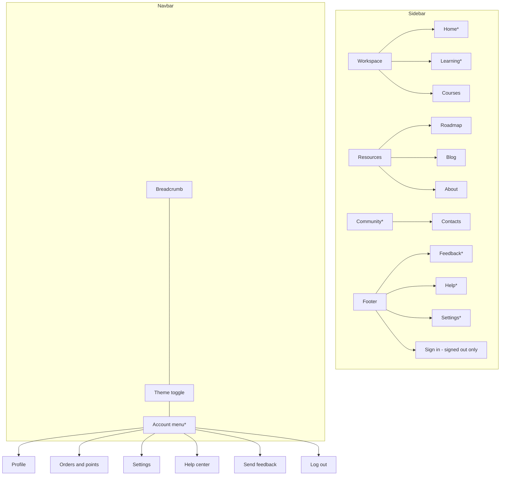
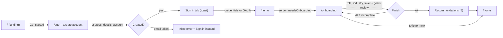
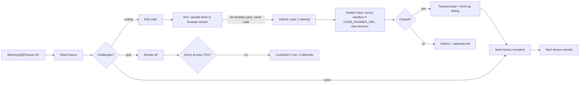

# Information architecture and user flows

Part of the CodeDev UI/UX plan. Master document: [UI_UX_MASTER_PLAN.md](./UI_UX_MASTER_PLAN.md).

"Current" describes code on `develop` (2026-10-19). "Proposal" items need product confirmation; none of them changes a business rule silently.

## 1. Route map

| Area | Route | Layout | Access (`auth/route/*.route.js`, `proxy.js`) | Main component |
|---|---|---|---|---|
| Public | `/` | Home | GUEST (signed-in → `/home`) | `components/index.js` |
| Public | `/course` | Home | PUBLIC | `course/coursePage.jsx` |
| Public | `/course/[id]` | Default | PUBLIC | `course/params/previewPage.jsx` |
| Public | `/roadmap`, `/roadmap/[id]` | Home / Default | PUBLIC | `roadmap/*` |
| Public | `/blog`, `/about`, `/help` | Home | public (not listed) | `blog/blog.jsx`, `about/aboutPage.jsx`, `help/helpPage.jsx` |
| Auth | `/auth` | Default | GUEST | `components/auth/authPage.jsx` (sign-in / create-account tabs) |
| Auth | `/auth/error` | none | public | `components/auth/errorPage.jsx` |
| Learning | `/home` | Home | PRIVATE + onboarding redirect (`app/home/page.jsx:23-26`) | `home/homePage.jsx` |
| Learning | `/learning` | Home | PRIVATE | `learning/learningPage.jsx` |
| Learning | `/learning/[id]` | Default | PROTECTED (`canAccessRoute`, else `/403`) | `learning/[id]/studyingPage.jsx` |
| Account | `/onboarding` | Default | PRIVATE | `onboarding/onboardingPage.jsx` |
| Account | `/profile`, `/settings`, `/contact` | Home | PRIVATE | `profile/*`, `settings/*`, `contact/contactPage.jsx` |
| Commerce | `/orders`, `/orders/[id]` | Home | PRIVATE | `commerce/ordersPage.jsx`, `orderStatusPage.jsx` |
| Commerce | `/checkout/mock/[orderId]` | Default | PRIVATE | `commerce/mockCheckoutPage.jsx` (mock provider only) |
| Admin | `/admin` | Home | PRIVATE + DB permission `admin.read` | `admin/adminPage.jsx` |
| System | `/403`, global 404 | none | public | `ui/forbidden.jsx`, `ui/pageNotFound.jsx` |
| CMS | `/studio/[[...tool]]` | none | public route, Sanity auth | `NextStudio` |

## 2. Navigation hierarchy

`*` signed-in only. Current gaps: `/admin` is linked from nowhere (UX-109); signed-out users reach Help only from the footer.

**Proposal (IA-1)**: keep the sidebar structure; add "Admin" under the account menu for users with `admin.read` (needs the permission on `/api/user/me`); rename "Contacts" to "Find learners" until community features exist (D-06).

**Proposal (IA-2)**: one rule for page chrome. Pages that are part of a learning session (`/learning/[id]`, `/onboarding`, `/checkout/*`) use `DefaultLayout` with a shared header bar; everything else uses `HomeLayout`. `/course/[id]` and `/roadmap/[id]` move to `HomeLayout` so that the sidebar stays during browsing (decision D-10).

## 3. Priority flows

Each flow lists entry, intent, steps, decisions, success, failure and recovery, routes, and mobile notes. Gaps refer to [CURRENT_STATE_AUDIT.md](./CURRENT_STATE_AUDIT.md).

### A. First visit → sign-up → onboarding → personalised dashboard

| Item | Current |
|---|---|
| Steps | Landing → `/auth` sign-up (2 steps) → toast → sign in → `/home` → server redirect to `/onboarding` → role → industry (optional) → level + goals → review → finish → recommendations → `/home`. |
| Decisions | OAuth vs credentials; skip onboarding; edit answers from review. |
| Recovery | Step state resumes from the server (`current_step`); preferences editable in `/settings#settings-preferences`; inline errors keep the draft. |
| Mobile | Single column; header "Skip for now" stays visible. |
| Gaps | Sign-up does not sign in (UX-105). Signed-out deep links lose their target (UX-104). |
| Proposal | After sign-up, sign in automatically and go straight to `/onboarding` (D-08). |

### B. Dashboard → discovery → course details → enroll or buy → learning

| Item | Current |
|---|---|
| Entry | `/home` recommendations, sidebar Courses, landing CTA. |
| Steps | `/course` (URL params `q`, `level`, `price`, `rating`, `language`, `category`, `role`, `industry`, `skill`; infinite scroll) → card action or `/course/[id]` → `PurchaseActions`. |
| Decisions | Free: enroll in place, then "Continue" to `/learning/[id]`. Premium: Buy (money offer) or Redeem (points offer), Owned, unlisted, not on sale. |
| Success | `/learning/[id]` opens on the first lesson. |
| Failure | Payments disabled (503) → inline "Online payment is not available yet"; ownership unknown → skeleton or Retry; `COURSE_ACCESS_REQUIRED` → "You need to buy or redeem this course". |
| Mobile | Course detail: cover + info stack, side by side on tablet. |
| Gaps | Enrolled courses are hidden from the catalogue; that is intentional (empty state links to My learning). |

### C. Course → lesson → challenge → run → submit → result

| Item | Current |
|---|---|
| Rules | Coding: 5 attempts max (`services/challenge.service.js:19`), a failed sample returns 409 without using an attempt. Quiz: 3 attempts, 5-minute cooldown, pass ratio 0.7. Mark complete is blocked until every open challenge is passed or out of attempts. |
| Recovery | Drafts in IndexedDB (800 ms debounce, flush on hide/unload); restore any submission; reset with confirmation; "attempt still counted" message when grading fails. |
| Mobile | Syllabus in a left Sheet; editor edge to edge, 16 px text, icon tabs. |
| Gaps | Lesson-complete reward feedback broken (UX-101); Python label without a Python runner (UX-108); no keyboard prev/next (UX-402). |

### D. Activity → EXP → level → feedback

| Item | Current |
|---|---|
| Sources | Lessons 10 EXP; quiz 5/8/12; `mini_coding` 10/20/35; `fix_bug` 8/15/25; course completion 50-200 (`docs/experience-leveling-design.md`). Points only from lessons and challenges (`docs/learning-rewards-redesign-plan.md`). |
| Feedback | `announceRewards` toast "+N points · +N EXP" (de-duplicated by id) and `LevelUpDialog` (`components/ui/level.jsx`). Level shown in the navbar trigger, account menu, studying header chip, `/home` overview, `/profile`. |
| Gaps | Lesson completion path silent (UX-101). Achievements, streaks and leaderboards do not exist (ranking is planned in `docs/ranking-plan.md`). |
| Proposal | No new gamification surfaces until the ranking plan is approved (D-05). |

### E. Return to an unfinished lesson

| Item | Current |
|---|---|
| Entry | `/learning` row "Continue" (no lesson param), dashboard course progress. |
| Resume | `/learning/[id]` without `?lesson=` picks the most recent `last_seen` lesson that is not locked, else the first; URL fixed with `replaceState`. Every opened lesson is recorded by `recordLessonVisitAction`. |
| Workspace | Newest of IndexedDB draft and server snapshot (last submitted code) wins; status chip says where it came from. |
| Gaps | Drafts are per browser; there is no server autosave (by design: server keeps the submitted code). Document this in the UI copy (Proposal: "Draft saved on this device"). |

### F. Premium purchase

| Item | Points | Money |
|---|---|---|
| Entry | "Redeem for N pts" on `/course/[id]` | "Buy for <price>" |
| Confirmation | Dialog: balance, cost, balance after; insufficient balance disables Confirm and explains how to earn | None in-app; redirect to provider checkout (mock only) |
| Result | "Course unlocked" + Start learning | `/orders/[id]` polls every 3 s while pending; completed / failed / cancelled / expired / refunded states with actions |
| Rules (from `docs/premium-onboarding-design.md`) | Points never negative; idempotent per key; prices set per course by admins | Pending order expires after 30 min; a late success still grants access; refunds only through provider webhook |

### G. Notifications

| Item | Current |
|---|---|
| Transient | Sonner toasts (`components/ui/alert.jsx`), one region, 4 s (8 s with an action). |
| Realtime | Pusher user channel: session revoked (sign-out), progress updated (refetch), challenge submitted (toast only when the tab is hidden), profile updated (refetch). |
| Persistent inbox | Not implemented. Planned in `docs/development-plan.md` §3.2; deferred in `docs/learning-rewards-redesign-plan.md` §3.4. |
| Proposal (D-04) | Notification centre: navbar bell with unread count, list page with read / unread / dismissed states, each item deep-links to its resource, "Mark all read". Order completion, access granted and level-up are the first item types. Toasts stay for confirmations of the user's own actions. |

## 4. URL and state conventions (current, keep)

- Lists keep search and filters in the URL (`hooks/useListQueryState.js`, `lib/listFilters.js`): typing replaces history, applying a filter pushes it.
- The learning page keeps the lesson in `?lesson=` and challenge anchors in `#challenge-<id>`.
- Modals that can be shared use a query param (`?modal=feedback`).
- Orders tab: `?tab=points`.
