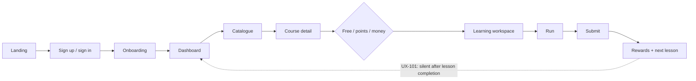

# CodeDev UI/UX master plan

Single source of truth for UI/UX work on CodeDev. Status: **for review**. No redesign starts until the decisions in section 10 are answered.

| Document | Content |
|---|---|
| [CURRENT_STATE_AUDIT.md](./CURRENT_STATE_AUDIT.md) | Findings with IDs (UX-xxx), evidence, severity, effort; measured baseline |
| [INFORMATION_ARCHITECTURE.md](./INFORMATION_ARCHITECTURE.md) | Route map, navigation, flows A-G with Mermaid diagrams |
| [DESIGN_SYSTEM_SPEC.md](./DESIGN_SYSTEM_SPEC.md) | Principles, tokens, typography, layout, forms, responsive rules |
| [COMPONENT_INVENTORY.md](./COMPONENT_INVENTORY.md) | Primitives, composites, duplicates (CI-xx), component specs |
| [IMPLEMENTATION_ROADMAP.md](./IMPLEMENTATION_ROADMAP.md) | Quick wins, phased backlog with effort, risk, DoD |
| [QA_AND_ACCESSIBILITY.md](./QA_AND_ACCESSIBILITY.md) | WCAG 2.2 AA criteria, responsive criteria, test strategy |

Related product documents (business rules this plan must respect): `docs/premium-onboarding-design.md`, `docs/experience-leveling-design.md`, `docs/learning-rewards-redesign-plan.md`, `docs/ranking-plan.md`, `docs/development-plan.md`, `docs/sandbox.md`.

## 1. Executive summary

CodeDev already has a solid base: one token-only colour system (violet brand, documented contrast, light and dark), shadcn/ui primitives, a responsive shell, and well-built core flows (resumable onboarding, URL-driven learning, a coding workspace with run/submit separation, drafts and history, idempotent purchases). After the fixes made on 2026-10-19, automated checks find **0 axe WCAG 2.2 AA violations** and **0 horizontal overflow** on all public routes in both themes at 5 widths.

The remaining problems are not visual polish but **feedback and resilience**:

1. Completing a lesson never shows its rewards because of a response-shape bug (UX-101, High).
2. There is no route error boundary; a render error shows the framework screen (UX-102, High).
3. Several states are hand-built per page (about 20 empty states, 9 error blocks, 3 progress bars, native selects, `window.prompt`), so behaviour drifts (UX-203 to UX-205).
4. Important outcomes live only in short toasts; there is no notification inbox (UX-107, UX-207).
5. Layout rules vary: six content widths, three page header bar copies, a sidebar that jumps after hydration (UX-201, UX-202, UX-301).

**Direction**: keep the current visual language (no wholesale redesign) and spend the effort on consistency, durable feedback, and test coverage. Estimated **≈ 37 person-days** without approval-gated features.

## 2. Current architecture and UI audit (summary)

See [CURRENT_STATE_AUDIT.md](./CURRENT_STATE_AUDIT.md) for every finding.

| Area | Verdict | Key evidence |
|---|---|---|
| Design tokens | Strong | `app/globals.css`; `--color-*: initial`; contrast pairs in comments |
| Component reuse | Medium | `card`, `switch` unused; CI-01..07 duplicates |
| Shared states | Weak | `PageError` 0 uses; no `error.js`; 2 files use `Empty` |
| Feedback | Weak in places | UX-101 rewards; toast-only errors (UX-207); no inbox |
| Responsive | Strong | 0 overflow at 320-1440; designed mobile Sheets and editor |
| Accessibility (automated) | Strong after fixes | 0 axe violations (public routes, signed-in routes re-measured) |
| Tests | Weak for UI | 14 Vitest files, all node-side; no component, a11y, e2e tests |

## 3. Route and page inventory

22 page routes. Full table with layout, access rule and component: [INFORMATION_ARCHITECTURE.md §1](./INFORMATION_ARCHITECTURE.md#1-route-map).

## 4. User flows

Flows A-G (first visit to dashboard, discovery to learning, lesson to submission, EXP feedback, resume, purchase, notifications) are documented with entry points, decisions, recovery paths and Mermaid diagrams in [INFORMATION_ARCHITECTURE.md §3](./INFORMATION_ARCHITECTURE.md#3-priority-flows).

## 5. Design principles and tokens

Principles: clarity over decoration, one next action per section, developer-friendly density, predictable navigation, durable feedback, responsive and accessible by default, reuse before create. Token tables, type scale, spacing, radius and motion rules: [DESIGN_SYSTEM_SPEC.md](./DESIGN_SYSTEM_SPEC.md).

Key token rules already in force:

- Colours only through tokens; Tailwind's default palette is removed.
- `text-primary-ink` for brand-coloured text (dark mode needs the lighter `#A78BFA`); `bg-primary` keeps white text.
- `--xp` amber for EXP and levels; `--editor*` / `--syntax-*` for every code surface.

## 6. Component strategy

Three layers (primitives, app composites, feature components). Adopt existing primitives before writing markup: `Progress`, `Collapsible`, `Select`, `Empty`, `ErrorReload`, `AlertDialog`. One new primitive is proposed (`Alert`). Details and specs: [COMPONENT_INVENTORY.md](./COMPONENT_INVENTORY.md).

## 7. Page-level proposals

| Page | Purpose / user | Main action | Current problems | Proposed improvements | Acceptance criteria |
|---|---|---|---|---|---|
| `/` landing | Visitor | Get started | Plain code sample (UX-209); no metadata (UX-211) | Highlight sample; metadata | axe 0; LCP image-free |
| `/auth` | Visitor | Sign in / create account | Sign-up does not sign in (UX-105); deep link lost (UX-104) | D-08, D-12 | Flow A completes in one session without retyping |
| `/onboarding` | New learner | Finish profile | Works well (resumable steps, review, skip, inline errors) | Keep as is | Resume from any step; skip never blocks the dashboard |
| `/home` | Learner | Continue learning | Several equal-weight blocks | "Next action" card first (R3-1) | One primary button above the fold at 375 px |
| `/course` | Visitor / learner | Find a course | Bespoke empty state (UX-205) | `Empty`; keep URL filters | Filters survive reload and back |
| `/course/[id]` | Visitor / learner | Enroll / buy / redeem | Not-found renders as `text-sm` (UX-206); no 404 status (UX-102) | `notFound()`; outcomes/prerequisites block when data exists (R3-2) | Correct 404; price state always explicit |
| `/learning` | Learner | Continue a course | 0-lesson course toast (UX-111) | Inline explanation | No dead-end clicks |
| `/learning/[id]` | Learner | Read, practise, complete | UX-101; Python label (UX-108); no keyboard prev/next (UX-402); off-scale sizes | QW-1, QW-3, R3-3, R1-3 | Rewards visible after completion; keyboard-only completion possible |
| `/profile` | Learner | Review progress | Hand-rolled progress (CI-02) | Primitives | |
| `/settings` | Learner | Update profile, sessions, preferences | Toast-only avatar errors (UX-207) | Inline errors | Errors stay until fixed |
| `/orders`, `/orders/[id]` | Buyer | Check order / points | h1 `text-xl` (UX-206) | h1 standard | |
| `/contact` | Learner | Find learners | Search only; raw fetching (UX-112, UX-501) | Rename (D-06); React Query | |
| `/admin` | Staff | Manage courses, access, orders | `window.prompt/confirm`, native selects, no nav link (UX-401, CI-01, UX-109) | Dialogs, `Select`, permission-based menu item | Keyboard-operable, reasons validated |
| `/blog`, `/help`, `/about`, `/roadmap*` | Visitor | Read | Missing metadata (UX-211); different widths (UX-201) | Metadata; width rules | |

## 8. Responsive and accessibility standards

WCAG 2.2 AA in both themes; 0 axe violations and 0 overflow at 320, 375, 768, 1280, 1440; touch targets ≥ 24 px (≥ 44 px for primary actions); dark mode measured after a reload, not by toggling a class. Full criteria: [QA_AND_ACCESSIBILITY.md](./QA_AND_ACCESSIBILITY.md).

## 9. Prioritised backlog: top 10

| # | Task | ID | Priority | Effort | Gated? |
|---|---|---|---|---|---|
| 1 | Fix lesson-complete rewards | QW-1 / UX-101 | P0 | 0.5 d | No |
| 2 | Route error boundaries and real 404s | R0-2 / UX-102 | P0 | 1.5 d | No |
| 3 | Remaining quick wins (broken link, Python label, breadcrumbs, metadata, landing sample, admin 403 shell, 768 boundary, empty course) | QW-2..9 | P0 | 2 d | No |
| 4 | Shared states: `Empty`, `ErrorReload`, `Alert` | R2-4 | P1 | 3 d | No |
| 5 | Inline errors instead of toast-only | R2-5 | P1 | 1 d | No |
| 6 | Sidebar without hydration jump | R2-1 | P1 | 1 d | No |
| 7 | Shell-preserving loading fallback | R2-2 | P1 | 1.5 d | No |
| 8 | Accessibility + overflow audit in CI | R6-1 | P1 | 2 d | D-11 (dev deps) |
| 9 | Layout widths and type hierarchy | R1-2, R1-3 | P1 | 2 d | D-02 |
| 10 | Dashboard next-action card | R3-1 | P1 | 1.5 d | No |

Quick wins and structural work are separated in [IMPLEMENTATION_ROADMAP.md](./IMPLEMENTATION_ROADMAP.md).

## 10. Risks, dependencies, assumptions, decisions

### 10.1 Decisions requiring approval

| ID | Decision | Options | Recommendation |
|---|---|---|---|
| D-01 | Overall direction | Keep current visual language and fix consistency / Redesign | Keep (no evidence that the visual language hurts tasks) |
| D-02 | Content widths | 3 widths (wide / form / reading) / keep per-page | 3 widths |
| D-03 | `Card` primitive | Adopt for panels / delete | Adopt only for panels with a header |
| D-04 | Notification centre | Build (5-8 d, backend + UI) / defer | Defer until order emails or a real payment provider exist |
| D-05 | Streaks, achievements, ranking UI | Per `docs/ranking-plan.md` / not now | Not now; remove unused `streak` tokens. Detailed UI proposal: [PROFILE_AND_LEADERBOARD_PLAN.md](PROFILE_AND_LEADERBOARD_PLAN.md) (personal rank first, public board after the production code runner) |
| D-06 | Community scope | Rename to "Find learners" / build friends and teams UI / hide | Rename |
| D-07 | Public profiles (`/profile/[id]`) | Build / remove links | Remove links now (done in QW-2). Build proposal: [PROFILE_AND_LEADERBOARD_PLAN.md](PROFILE_AND_LEADERBOARD_PLAN.md) §3 |
| D-08 | Sign-up then automatic sign-in | Yes / no | Yes (auth change, needs security review) |
| D-09 | Expose permissions on `/api/user/me` for an Admin menu item | Yes / no | Yes, read-only list |
| D-10 | `/course/[id]`, `/roadmap/[id]` layout | Move to `HomeLayout` / keep `DefaultLayout` | Move (keeps navigation while browsing) |
| D-11 | Test dev dependencies (Playwright, Testing Library, jsdom) | Add / not | Add |
| D-12 | Return URL after sign-in | Add same-origin `callbackUrl` / not | Add (auth change, needs security review) |

### 10.2 Risks and dependencies

| Risk | Mitigation |
|---|---|
| Auth and payment behaviour must not change during visual work | D-08, D-12, R5-4 are separate, approval-gated tasks |
| Integration tests that run as the real admin sign that account out (found during this audit; fixed in `__tests__/auth/session.integration.test.js`, uncommitted) | E2E uses a seeded throwaway user only |
| Large uncommitted working tree on `develop` | Land roadmap tasks as small PRs |
| Only a mock payment provider exists | Purchase UX for real providers is out of scope until chosen |
| Coding EXP can be faked until `CODE_RUNNER_URL` is enabled (`docs/experience-leveling-design.md`) | Product risk, not UI; noted for gamification decisions |

### 10.3 Assumptions

- Learners use laptops for coding and phones for reading and tracking progress.
- JavaScript is the only runnable language for now (`docs/sandbox.md`).
- Vietnamese and English text must both render (font subsets already include Vietnamese).

## 11. Acceptance criteria and success metrics

No analytics library is installed, so most baselines must be computed from the database or added as events (Proposal). Do not set numeric targets until a baseline exists.

| Metric | How to measure | Baseline |
|---|---|---|
| Onboarding completion rate | `onboarding` rows: completed / (completed + skipped + in progress) | Query needed |
| Time to first meaningful action | Signup timestamp → first lesson visit (`last_seen`) | Query needed |
| Course enrolment conversion | Course detail views (event, proposal) → enrolments / redemptions | Needs view events |
| Lesson continuation rate | Learners with a lesson visit in the 7 days after a previous visit | Query needed |
| Coding submission success rate | Passed / total submissions per challenge (`challenge.code_submissions`) | Query needed |
| Task completion (usability) | 5-learner sessions on flows A, C, E | Not measured |
| Form error rate | Client event on validation failure (proposal) | Not measured |
| Accessibility violations | axe in CI (R6-1) | **0** on public routes (2026-10-19) |
| Mobile usability defects | Overflow + touch-target checks; issues tagged `mobile` | **0** overflow (2026-10-19) |
| UI regressions | Visual regression diffs per PR (R6-3) | Not measured |

## 12. Validation performed for this plan

- Code reading of routes, layouts, components, flows, data fetching, forms and tests (three read-only passes plus spot checks of cited lines, for example UX-101 and UX-103).
- Automated Playwright + axe audit of 20 routes at 5 widths in light and dark (signed out), and 6 signed-in routes in the browser.
- Contrast calculations for every token pair changed in this session.
- Not performed: screen-reader testing, real devices, usability sessions, performance profiling, `npm test` for this documentation change (no code changed).
